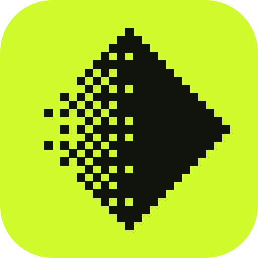
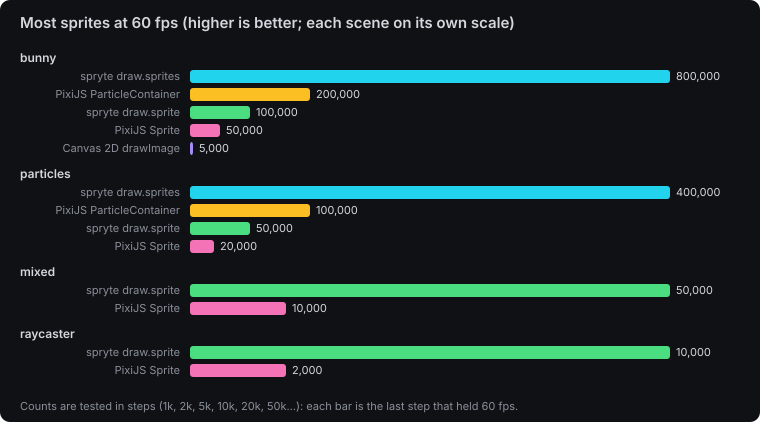
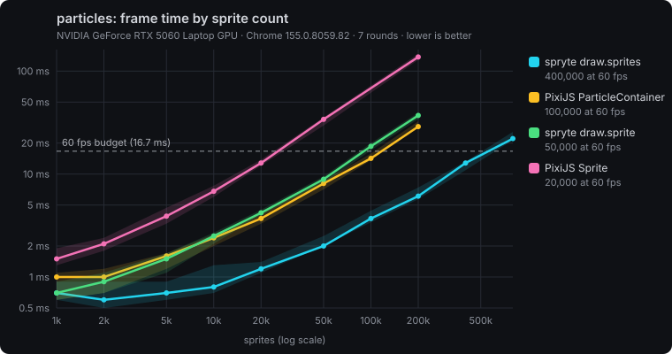

# spryte

**Blazing fast 2D rendering for the web: 2–4× faster than the most popular renderer, at a ninth of its size.** Every number is checked pixel for pixel in [2dbench](https://github.com/debuffjp/2dbench), an open benchmark you can [run on your own device](https://debuffjp.github.io/2dbench/mobile.html).

You draw in immediate mode (sprites, bulk sprites, rects, circles, lines, text, clips, blend modes, render targets and custom shaders), and spryte batches it onto WebGL2 with instancing, falling back to Canvas 2D automatically. No dependencies, no scene graph, no game framework.

> **Alpha.** spryte is the renderer inside [debuff](https://debuff.jp), where games already run on it. The API may still change before 1.0. It's measured on desktop Chrome and Chromium (Windows and Linux; NVIDIA and AMD GPUs), iPhone Safari and Chrome, and Firefox on Android, and its one-call-per-sprite path is ahead of PixiJS on every device so far ([results across devices](https://github.com/debuffjp/2dbench#across-devices)). Safari on macOS isn't covered yet: [run 2dbench on your device](https://debuffjp.github.io/2dbench/mobile.html) to help.

```bash
npm install spryte
```

```ts
import { createRenderer } from "spryte";

const draw = createRenderer(canvas, { smooth: false }); // smooth: false for pixel art
canvas.width = 640;
canvas.height = 360;
draw.resize(canvas.width, canvas.height);

function frame() {
  draw.begin("#111", 320, 180, 2); // clear colour, logical size, backing pixels per logical unit
  draw.rect(10, 10, 40, 20, "#cffb2d");
  draw.sprite(image, 160, 90, { rotation: 0.3, tint: "#f0f" });
  draw.text("hello", 8, 8);
  draw.end();
  requestAnimationFrame(frame);
}
requestAnimationFrame(frame);
```

## Why spryte

Against PixiJS 8 on the same machine, assets and simulation, over 3 interleaved rounds, after a pixel-parity gate (desktop Chrome, RTX 5060 laptop). The comparison survived an adversarial fairness review, which lowered two of our earlier numbers. Method, raw data and caveats are in [benchmarks](https://github.com/debuffjp/spryte/blob/main/docs/benchmarks.md).

| | spryte | PixiJS 8 | |
| --- | --- | --- | --- |
| JS at startup (brotli) | **10.1 kB** | 87.8 kB | ~9× smaller |
| 200k particles, per-particle scale, rotation, tint and alpha all changing | **7.7 ms** | 28.9 ms (`ParticleContainer`) | 3.8× faster |
| 50k sprites with rotation, scale and tint, one call each | **9.8 ms** | 32.3 ms (`Sprite`) | 3.3× faster |
| 200k sprites, position only, bulk | **4.4 ms** | 8.9 ms (`ParticleContainer`) | 2.0× faster |





*Charts from [2dbench](https://github.com/debuffjp/2dbench) (3–7 rounds depending on the scene; the table above is spryte's own bench, 3 rounds). Lower lines are faster; the dashed line is the 60 fps budget.*

In [2dbench](https://github.com/debuffjp/2dbench)'s raycaster scene (a retro first-person maze drawn as thousands of texture slices), spryte held 10,000 enemies at 60 fps against PixiJS `Sprite`'s 2,000. The gap is per-sprite work: a PixiJS `Sprite` is a scene-graph object updated, bounded and batched every frame, while spryte writes a few numbers per sprite into a typed array and the GPU expands them. Static scenes, where PixiJS can cache, are much closer.

- **Bulk sprites with no per-sprite JavaScript.** On WebGL2, pass a `Float32Array` of positions (plus optional per-copy scale, rotation and colour arrays) and spryte uploads it as is.
- **Immediate mode.** There are no display objects to create, pool or destroy. Draw what you want this frame.
- **Verified output.** Real-GPU pixel checks prove that the bulk paths, render targets and shaders draw exactly what the simple path draws.

```ts
// Particles: one call, no objects.
draw.sprites(spark, positions, count, { tint: "#ffd36b" }, { scale, rotation, color });

// Post-processing: draw into a target, then draw the target through a shader.
draw.into(scene, () => drawWorld(draw));
draw.withShader(crt, () => draw.sprite(scene, 0, 0, { origin: [0, 0] }));
```

## Docs

- [API reference](https://github.com/debuffjp/spryte/blob/main/docs/api.md)
- [Architecture](https://github.com/debuffjp/spryte/blob/main/docs/architecture.md)
- [Benchmarks and method](https://github.com/debuffjp/spryte/blob/main/docs/benchmarks.md)
- [Minimal example](https://github.com/debuffjp/spryte/tree/main/examples/minimal): run `npm run example`, and add `?backend=2d` to the URL to see the fallback

## Lifecycle

- `createRenderer(canvas, options)` makes a `Draw`. It uses WebGL2 when available, and otherwise Canvas 2D, loaded on demand. `await draw.ready` waits until the fallback can draw.
- You own the canvas size. After changing `canvas.width` or `canvas.height`, call `draw.resize(w, h)`.
- Each frame: `draw.begin(...)`, then your draw calls in order, then `draw.end()`. Call order is draw order.
- `draw.invalidate(source)` re-uploads an image whose pixels changed. `draw.disposeTarget(t)` frees a render target.
- `draw.dispose()` releases every GPU resource and listener. Using a disposed `Draw` throws.
- WebGL context loss is handled: drawing pauses while the context is lost (`draw.contextLost`), and textures re-upload after it's restored. Render targets come back blank. This is checked with a real GPU context loss in `npm run test:browser`.

## Sponsors

spryte, debuff and 2dbench are free and MIT licensed. [Sponsor on GitHub](https://github.com/sponsors/debuffjp) to keep them that way: from Power-up ($100/month) your logo goes here and on [debuff.jp](https://debuff.jp), with bigger placements as you level up. Studios after performance help or a bigger partnership: [greg@updog.jp](mailto:greg@updog.jp).

## Licence

MIT
